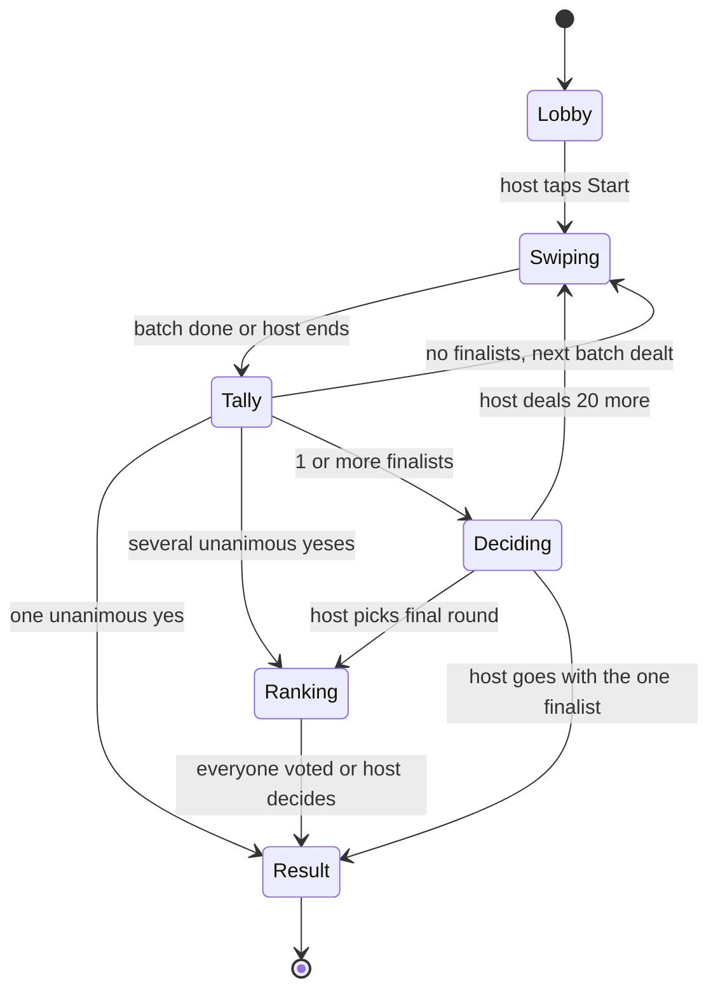

# Restaurant Picker Project Spec

Nov 4, 2026 · @Darren Ath-Ly

## Overview

A mobile-first web app that takes a group of 2 to 8 friends from "where should we eat?" to a decision in about five minutes. The host sets filters, friends join from a link with no account, and everyone adds the spots they want. The group then swipes yes, no, or veto on those adds plus nearby suggestions, dealt in batches of 20, and a voting rule picks the winner from the places people approved.

The app works anywhere Google Places has data. Testing and the first launch focus on Boston, Cambridge, and Somerville, and V2's curated menu highlights cover only that area. The look borrows Too Good To Go's photo cards and bottom sheets, and the longer-term idea borrows Beli's taste memory. The stack is Next.js, Supabase, and Vercel, built with Claude Code.

## Features

The MVP is the full loop for one group in one sitting. Everything that needs accounts, history, or extra APIs waits for V2.

### MVP

- **Create a session.** Host names it, picks a starting area (typed with autocomplete and resolved to a point, or their own location), how far they'll go (0.5, 1, 2, or 5 miles), which price levels work ($ to $$, any mix), optional cuisines, open now, and vegetarian options, then gets a link and a 6-character code. The host's member row is created with the session.
- **Join with no account.** Friends open the link, type a display name, pick an avatar color nobody in the group has yet, and share their location or type a starting area. Anonymous sign-in happens behind the scenes, and locations are stored rounded to about 100 m.
- **Lobby built around adding.** Everyone sees who has joined and every spot the group has added, in real time. Only the host can start.
- **Add spots (no limit).** Adding is the main lobby activity. Anyone can add as many restaurants as they want by searching a place or a dish, or from the explore map. Adds skip the price and distance filters but still show both on the card. Adding a spot counts as a yes from whoever added it, and they skip their own adds while swiping. Duplicates are rejected, members can remove their own adds, and adds close when the host starts picking. A quiet cap of 40 adds per session applies, shown only when reached. Search runs through `GET /api/places/autocomplete` with session tokens; `POST /api/sessions/[id]/add` checks the cap and duplicates, fetches Place Details with the standard field mask and one photo, and inserts with `source = 'member'`.
- **Explore map.** A full-screen Google Map reached from the lobby's add bar and map button. Members search by place name or dish (Text Search), filter with chips, and browse results as pins plus a bottom-sheet list. Panning shows "Search this area" instead of searching automatically. Spots already added show as checked pins.
- **Deck order.** When picking starts, batch 1 is the group's adds first (deduped by place ID), then suggestions from Text Search that fit the filters, filling the batch to 20. The host can turn suggestions off so the deck is only the group's adds. If adds alone exceed 20, they fill batches first, dealt round-robin by member so no one's list crowds out the others. Cards look the same whether a spot was added or suggested, and who added a spot stays hidden from everyone else.
- **Swipe deck.** Restaurant cards with photo, name, price level, rating, distance from you, and an "open until" badge. Tapping a card opens a bottom sheet with hours, website or menu link, dietary flags, and a Google Maps link.
- **Yes, no, veto.** Swipe right, left, or up, with buttons as a fallback. Each person gets 2 vetoes.
- **Fair deck order.** Adds always come before suggestions. Within each group, every member sees the cards in a different shuffled order (seeded by their user id and the batch number, so a reload keeps it), so early cards don't get extra yeses. A member's own adds are left out of their deck, since adding counted as their yes.
- **Hidden tallies.** Nobody sees vote counts until everyone finishes, only how many people are still swiping.
- **Instant match.** If every member says yes to the same place, skip ranking and show it.
- **Final round.** The host picks how the group decides in the lobby, and it locks when picking starts so the rule can't be chosen after the finalists are known. One vote each (plurality): everyone picks one finalist, most votes wins. Ranked points (Borda count, default): everyone ranks the finalists; with k finalists, first place earns k − 1 points. Quadratic votes: everyone spreads 9 credits, where v votes on one spot cost v² credits; votes are whole numbers of zero or more, and most total votes wins.
- **Result screen.** Winner, runner-up, directions link, and a button to run it again.
- **Host controls.** The host can end swiping early when someone stalls. Unswiped cards count as no.
- **Batches with no cap.** Cards come 20 at a time, and everyone finishes a batch before the next one is dealt. After each batch, a single unanimous yes wins outright, several unanimous yeses go straight to the final round, 2 or more finalists let the host choose the final round or 20 more, 1 finalist lets the host go with it or deal 20 more, and no finalists deals the next batch automatically.
After each ba
### Later (V2)

- **Accounts and saved groups.** Upgrade anonymous users to Google sign-in so recurring friend groups persist.
- **Post-dinner ratings.** Beli-style ratings after the meal, used to suppress recent repeats and seed future decks.
- **Menu highlights.** Popular dishes and price ranges for a curated set of about 150 Boston and Cambridge restaurants.
- **Wildcard card.** One highly rated place per deck that misses a soft preference.
- **Install and notifications.** PWA install plus a push when everyone has finished swiping.

## Pages and screens

The app has four routes. The session page at `/s/[code]` swaps views based on the session's status, so Realtime updates move everyone forward without a page navigation; Explore has its own URL under it so Done is a plain navigation back.

### Desktop layout

Mobile is the primary design. At 1024px and wider, screens adapt instead of stretching.

- **Flow screens** (Join, Create, Done, Final round, Voting method, Winner): a centered 480px column on the page background. Buttons pinned to the bottom on mobile become regular buttons at the end of the column.
- **Welcome**: two columns, max 1040px. Photo on the left, headline and actions on the right.
- **Lobby**: two columns, max 1040px. Left: the add bar and the added-spots list. Right: members, voting method, suggestions, and Start.
- **Swipe**: two columns, max 1040px. Left: the map, sticky and full height. Right: the card and vote buttons. Keyboard: Left arrow for No, Right arrow for Yes, V for Veto, Enter for Details, ignored while typing in a field.
- **Explore**: the map fills the window, with results in a 400px left panel instead of a bottom sheet.
- **Sheets**: bottom sheets become centered dialogs at 1024px and wider, max 960px for details (as in docs/design/08-details-desktop.png) and 520px for filters and the voting method.
- Check every screen at 390×844 and 1280×800.

### Routes

| Route | Screen | What it shows |
| --- | --- | --- |
| `/` | Home | Start a group button and a field to type a join code |
| `/new` | Create session | Filter form (price, max distance, open now, vegetarian) and the host's display name |
| `/s/[code]` | Session | One of the views below, picked by session status |
| `/s/[code]/explore` | Explore | Lobby only (members are sent back to `/s/[code]` otherwise): search, results with Add, and the map |

### Views inside `/s/[code]`

| View | When | What it shows |
| --- | --- | --- |
| Join | First visit to the link | Who's in, the host's invite, a display name and avatar color, and a location prompt |
| Lobby | Status is lobby | Add bar (search a place or dish, plus a map button), the group's added spots with remove on your own, the voting method (host can change it), the host's suggestions toggle, avatars, invite button, and the host's Start button |
| Explore | Opened from the lobby's add bar or map button | Full-screen map with search, filter chips, result pins, and a results sheet with Add buttons. Typing shows autocomplete predictions: a place prediction adds that spot straight away (its Place Details call ends the autocomplete session), a dish prediction or Enter runs one Text Search. Phase 6 part 1 ships the search and the list; the map, pins, "Search this area," filters, and the details sheet follow in part 2 |
| Swipe | Status is swiping | Map strip on the top 30% with the current pin and member dots, card deck below, vetoes left, and the details bottom sheet on tap. A vote is a deliberate horizontal swipe or a button; a tap opens details. Votes are written optimistically (insert, then update on conflict), rolled back with a retry toast if the write fails, including the database refusing a third veto. The member resumes at their first unswiped card after a reload |
| Waiting | You finished the current batch | "3 of 5 done with this batch" with no vote counts and the host's End swiping button. When everyone finishes, the host picks Go to ranking or Deal 20 more |
| Deciding | Status is deciding | The finalists as compact rows with no vote counts. The host picks Go to final round (Go with it for one finalist) or Deal 20 more; guests see "Waiting for Sam to decide." With no finalists at all the area ran out of places: the "Nothing matches these filters" edge state, with Widen for the host |
| Final round | Status is ranking | The session's method: pick one finalist, drag the finalists into order, or spread 9 quadratic credits with steppers |
| Result | Status is done | The winner's photo and card, Get directions (a Google Maps link by place id), Hours, photos and reviews (the details sheet), the runners-up in final order, and Start a new dinner |

### Map strip

A Google Map sits above the card on the swipe screen and takes about 30% of the height. It re-centers on each new card's pin and shows every member's dot, so the group can see at a glance whether a place is fair for everyone.

- **Google Map only.** Places results shown on a map must be on a Google Map, so Mapbox and MapLibre are out ([Places API policies](https://developers.google.com/places/web-service/policies)). A Google Map on the same screen also covers Google's attribution requirement, though photo author attributions still show on each card.
- **No gestures.** `gestureHandling="none"` sends sideways drags to the card instead of the map. Tapping the strip opens a full-screen map to look around; adding is closed once picking starts.
- **One load per phone.** Create the map once per session and pan it. Dynamic Maps get 10,000 free loads a month, then $7 per 1,000, which covers about 2,000 five-person sessions.
- **Second key.** The Maps JavaScript key runs in the browser, so restrict it by HTTP referrer to the Vercel domains. The Places key stays server-only.
- **Library.** `@vis.gl/react-google-maps` with `AdvancedMarker` pins, which need a Map ID.

### Server routes

These run on Vercel with the secret keys. Swipes write straight to Supabase, guarded by row-level security. Final-round ballots go through the ballot route so they can be validated.

| Route | Does |
| --- | --- |
| `POST /api/sessions` | Creates the session, its join code, and the host's member row |
| `PATCH /api/sessions/[id]` | Host only, lobby only. Changes `voting_method` and `suggestions_on` |
| `GET /api/places/autocomplete` | Name and dish suggestions for the add bar, using session tokens, biased to the session's area |
| `GET /api/places/area` | Starting-area predictions for Create and Join (a neighborhood, landmark, or address), with a session token, biased to the US. Needs no session |
| `GET /api/places/area/[placeId]` | Resolves a picked area with a Place Details call for only `location` and `formattedAddress`, on the same token, which becomes the session's center or the member's location |
| `GET /api/places/search` | The explore map's search and "Search this area," one Text Search call per request |
| `POST /api/sessions/[id]/add` | Lobby only. Adds a member's spot: checks the session cap and duplicates, fetches Place Details and one photo, inserts with `source = 'member'` and an `adds` row |
| `DELETE /api/sessions/[id]/add/[placeId]` | Lobby only. Removes one of the caller's own adds |
| `POST /api/sessions/[id]/start` | Host only, lobby only. Builds batch 1 from the group's adds, then fills to 20 with one Text Search call if suggestions are on, resolves photos, records each adder's yes, moves status to swiping |
| `POST /api/sessions/[id]/done-swiping` | Marks a member done with the batch (a conditional flip, so a repeat changes nothing). Once the whole group is, the tally runs over every dealt card so far (`lib/finish-batch.ts`): the transition is claimed with `update sessions set status = 'deciding' where status = 'swiping' and batch = N`, so it runs once; then a single unanimous yes writes the result and ends the session, several go straight to ranking, finalists wait for the host in deciding, and none deals the next batch (or leaves deciding empty when the area is out of places) |
| `POST /api/sessions/[id]/deal` | Host only, from deciding. Deals the next 20: remaining adds first, then the next page of suggestions, or splits the area into smaller circles past 60, filtering by distance. Resets everyone's done flag for the new batch and drops the finalists |
| `POST /api/sessions/[id]/final-round` | Host only, from deciding. The stored finalists go to ranking |
| `POST /api/sessions/[id]/go-with-it` | Host only, from deciding with one finalist. It becomes the winner and the session is done |
| `POST /api/sessions/[id]/widen` | Host only, from deciding with no finalists. Widens the max distance one step, restarts the suggestions search at the new radius, and deals |
| `POST /api/sessions/[id]/ballot` | Saves the member's final-round ballot after checking it matches the session's method (one valid pick, a full ordering, or whole-number votes costing at most 9 credits), marks them done, and once everyone has voted ends the round (`lib/finish-ranking.ts`): scores with `score`, orders with `pickWinner` (yeses, rating, the session-seeded coin flip), writes the result with the final order and moves to done behind `where status = 'ranking'` |
| `POST /api/sessions/[id]/end-ranking` | Host only, while ranking. "Decide without": ends the round with the ballots in so far; missing ballots are left out |
| `POST /api/sessions/[id]/end-swiping` | Host only. Marks everyone done (their unswiped cards count as no at the tally) and runs the same finalist step |

## Session lifecycle

Everyone adds spots in the lobby, and adding closes when the host taps Start. The server tallies after every batch of 20, once everyone finishes it or the host ends swiping. A unanimous yes goes straight to the result. Otherwise the host either sends the finalists to ranking or deals 20 more, and a batch with no finalists deals the next one automatically.

## Voting design

Swipes are approval ballots with a veto, and the host's chosen method (plurality, Borda count, or quadratic voting) picks the winner from the top 5 finalists. All of it lives in `lib/voting.ts` as pure functions with Vitest tests, and it runs on the server so no client can tamper with the result.

1. **Swipe.** Each member marks every card in the current batch of 20 yes, no, or veto, and the next batch is dealt only after everyone finishes. A member's own adds count as their yes automatically and are skipped in their deck. Vetoes are capped at 2 per person for the whole session. Cards left unswiped when the host ends swiping count as no.
2. **Instant match.** A restaurant with a yes from every member wins outright. If several are unanimous, only those go to the ranking round.
3. **Finalists.** Drop every vetoed restaurant. Keep places where at least half the members said yes, then take the top 5 by yes count. If fewer than 2 qualify, relax to at least one yes.
4. **Final round.** Each member submits one ballot in the session's method. Plurality: one pick, one point. Borda: a full ordering; with k finalists, first place earns k − 1 points and last place earns 0. Quadratic: whole-number votes per finalist whose squares sum to at most 9; a finalist's score is its total votes. The method is stored on the session and locked at Start.
5. **Tie-break.** Higher final-round score, then more yeses, then higher Google rating, then a coin flip seeded by the session id so it is reproducible.

### Edge cases

| Case | Rule |
| --- | --- |
| One member | Skip the final round if they said yes to exactly one place. Otherwise they vote on their yeses in the session's method. |
| Zero finalists | Deal the next batch automatically. If the area runs out of places, offer to widen the max distance. |
| Someone stalls | Host ends swiping. Their missing swipes count as no, and a missing ballot is left out of the final round. |
| Two members finish at once | The status change uses a conditional update (`where status = 'swiping'`), so it runs exactly once. |
| Member joins after start | They can watch but don't vote this round. |
| Adds exceed 20 | Adds fill batches first, round-robin by member. Suggestions come only after every add has been dealt. |
| Two members add the same spot | One card, and it counts as a yes from both. |
| Two finalists | Same as three or more: the host picks Go to final round or Deal 20 more. |
| One finalist | The host picks Go with it, which makes it the winner, or Deal 20 more. |

Tallies stay hidden during swiping to cut strategic voting. Adds deliberately come before suggestions, since they are what the group actually wants; within each, per-member shuffles cancel the bias toward early cards. Because everyone sees every dealt card before the next batch, approval counts stay comparable even with no cap on the deck. Adding many spots gives no extra influence, since each spot still needs yeses from half the group and no veto. Every finalist already passed the approval threshold, so plurality's usual flaw of electing something most people dislike is limited here. Borda can be gamed by burying a rival, which is fine among friends. With a single decision, quadratic voting mostly behaves like plurality, since anyone with a clear favorite puts all 9 credits into 3 votes for it; it differs only for people torn between two spots. The method locks at Start so the host can't pick a rule after seeing which one favors their spot.

## Data sources

Each member add takes one Place Details call and one photo. Suggestions take one Google Places search per batch, and every dealt card needs one photo. Menus have no API, so the MVP links out.

| Source | Used for | Calls | Version |
| --- | --- | --- | --- |
| Places API (New) Autocomplete | Name and dish search in the add bar | Free when the search ends in a Place Details call | MVP |
| Places API (New) Place Details | Each spot a member adds | 1 per add | MVP |
| Places API (New) Autocomplete + Place Details (Essentials) | A typed starting area on Create or Join | 1 session + 1 location-only details call per typed area | MVP |
| Places API (New) Text Search | Suggestions after the group's adds, up to 60 per area at 20 per page, plus explore map searches | 1 per batch of suggestions, 1 per explore search | MVP |
| Places API (New) Nearby Search | Suggestions past 60: the area becomes seven smaller circles (the center and six around it at 0.6 r, each r/2), one call per circle until the batch fills, duplicates removed by place ID, and price and open-now applied in code since Nearby has no such filters | 1 per smaller circle | MVP |
| Places API (New) Place Photos | One photo per card | 1 per add or suggestion | MVP |
| Restaurant's own website | Menu link in the bottom sheet | 0 | MVP |
| Curated menu summaries | Popular dishes for about 150 restaurants | 0 (built once) | V2 |

Nearby Search returns at most 20 places with no next page, which is why suggestions start with Text Search. When paging, every request field except the page token must match the first request, so the session stores the original request body and the latest `nextPageToken` (`search_body` holds `{ body, nearbyNext }`: that body plus how many of the smaller circles have been used; `page_token` holds the token). Text Search treats the circle as a preference, not a hard limit, so suggestions are filtered by distance before they are dealt. Suggestions begin only once every add has been dealt, and the first Text Search happens whenever that first fill is needed, which can be a later batch when the group added more than 20. A batch comes up short rather than costing a second search; when the circles are used up too, the deal route reports the area as exhausted so the host can widen the distance.

### Search field mask

Google bills a request at the highest tier among the fields you ask for ([source](https://developers.google.com/maps/billing-and-pricing/sku-details/places)). Cards need fields from three tiers, and Place Details for adds uses the same fields.

| Tier | Fields |
| --- | --- |
| Pro | `places.id`, `places.displayName`, `places.location`, `places.photos`, `places.googleMapsUri`, `places.primaryTypeDisplayName` (the cuisine line), `places.utcOffsetMinutes` (to print "open until 11 PM" in the place's own time) |
| Enterprise | `places.rating`, `places.userRatingCount`, `places.priceLevel`, `places.currentOpeningHours`, `places.websiteUri` |
| Enterprise + Atmosphere | `places.servesVegetarianFood` |

The vegetarian flag pushes every search and every Place Details call to the top tier. That costs nothing extra inside the free caps, since the Enterprise tiers get 1,000 free calls a month per SKU.

### Photos

The server resolves each photo once with `skipHttpRedirect=true` when a spot is added or dealt, and stores the returned `photoUri` on the restaurant row. Every member's browser loads that URI directly, so each card costs one photo no matter how many people join. A proxy route would bill once per photo per phone instead.

Store Places content only for the life of a session, and read Google's terms before keeping anything longer.

## Tech stack and data model

Browsers talk to Supabase directly for auth, reads, swipes, and live updates. Anything that needs a secret key or decides an outcome runs in a Next.js server route on Vercel.

### Stack

| Layer | Choice | Role |
| --- | --- | --- |
| Framework | Next.js App Router, TypeScript | Pages plus server routes that hold secret keys |
| Styling and motion | Tailwind, Motion | Mobile-first layout and swipe gestures |
| Database and auth | Supabase Postgres, anonymous sign-in | Session data, row-level security, no-signup joins |
| Live updates | Supabase Realtime | Lobby presence, the growing add list, and status changes pushed to every phone |
| Hosting | Vercel | HTTPS preview URL per push, needed for phone geolocation |
| Tests | Vitest | Unit tests for `lib/voting.ts` |
| Build tool | Claude Code with the Supabase MCP server | Writes code and applies migrations on the dev project |

### Tables

| Table | Key columns | Members can read | Members can write |
| --- | --- | --- | --- |
| `sessions` | `id`, `code`, `host_id`, `name`, `status` (lobby, swiping, deciding, ranking, done), `filters` (jsonb), `suggestions_on`, `voting_method` (plurality, borda, quadratic), `center_lat`, `center_lng`, `batch` (batches dealt so far), `search_body` (jsonb: the Text Search body plus the nearby-circle count), `page_token` | Their own session | Nothing (server only) || `members` | `session_id`, `user_id`, `display_name`, `color` (1 to 8, unique per session), `lat`, `lng`, `vetoes_left`, `done_swiping` (current batch), `done_ranking` | Everyone in their session | Their own `display_name`, `lat`, `lng`; joining goes through `join_session` |
| `restaurants` | `session_id`, `place_id`, `source` (member or suggested), `batch` (null until dealt), `data` (jsonb with name, price, rating, `photoUri`, hours, links, flags) | Their session's spots | Nothing (server only) |
| `adds` | `session_id`, `user_id`, `place_id`, `created_at`; unique per user and place | Only their own | Nothing (server only) |
| `swipes` | `session_id`, `user_id`, `place_id`, `value` (yes, no, veto); unique per user and place | Only their own | Only their own |
| `ballots` | `session_id`, `user_id`, `payload` (jsonb: `{pick}`, `{ordering}`, or `{votes}` by method); unique per user | Only their own | Nothing (server only, through the ballot route, which validates against the session's method) |
| `results` | `session_id`, `finalists`, `scores` (jsonb), `winner_place_id`, `runner_up_place_id` | Their session's result | Nothing (server only) |

Because members can only read their own swipes, tallies stay hidden by the database itself, not just the UI. The same goes for adds: members can read only their own `adds` rows, which is how the lobby marks "You added this" without revealing who added anything else. The server reads all swipes and adds with the secret key when it builds batches and computes finalists, and it writes each adder's automatic yes into `swipes` when their spot is dealt.

Grants follow the table above. `authenticated` (the role anonymous sign-ins use) gets select on everything a member can read, plus insert and update on `swipes` and update on `members`, limited to the columns a phone legitimately sets (`display_name`, `lat`, `lng` on members; `value` on swipes, plus the key columns on a swipe insert). Member rows are inserted only by `join_session` and the sessions route, which is how the 8-person cap and the unique colors hold. Ballots are written only by the ballot route, because a quadratic ballot's credit budget has to be checked on the server. `vetoes_left`, the done flags, and `created_at` stay server-owned. A trigger on `swipes` spends one of `vetoes_left` for every veto, refunds it when that veto is changed to yes or no, and rejects a veto once none are left, so the limit holds no matter which client writes the swipe. A check constraint on `ballots.payload` allows exactly one of the three shapes, and the ballot route checks everything else. Because a PostgREST upsert sets every payload column, clients insert and then update instead of upserting. `anon` gets nothing, and `service_role` is granted everything explicitly because new Supabase projects give the API roles no table access by default. The membership check behind every "their session" policy is `private.is_session_member`, a security-definer function in a schema the Data API does not expose. `sessions`, `members`, and `restaurants` are in the Realtime publication, and Postgres Changes applies the same select policies to inserts and updates, so a phone only receives rows it could read. Delete events are not filtered by RLS and carry only the old row's keys, so clients never apply an event's payload: on any event they refetch that table for their session through RLS. Migrations live in `supabase/migrations/` and are applied to the dev project through the Supabase MCP server, `lib/database.types.ts` is regenerated after each one, and `npm run rls:check` proves with two anonymous users that members can't read each other's swipes, adds, or ballots, can't write ballots or adds, and can't insert a third veto. `sessions.filters` holds `{areaLabel, distanceMi, prices, cuisines, openNow, vegetarian}`, validated by `lib/session-filters.ts`.

### Environment variables

| Variable | Exposed to browser |
| --- | --- |
| Supabase URL | Yes |
| Supabase publishable key | Yes |
| Supabase secret key | No |
| `GOOGLE_PLACES_API_KEY` | No |
| `NEXT_PUBLIC_MAPS_KEY` | Yes (restricted to Maps JavaScript API and your domains) |
| `NEXT_PUBLIC_MAP_ID` | Yes |

## Costs

Running the MVP costs $0 a month up to about 50 batches of 20 cards across all groups. Past that, each batch costs about $0.18 in Google fees, and the only fixed cost is a Claude plan for Claude Code if you don't already have one.

### By service (USD)

| Service | Plan | Free allowance that matters | Price past it | MVP cost |
| --- | --- | --- | --- | --- |
| Google Text Search (Enterprise + Atmosphere) | Pay as you go | 1,000 calls a month | $40 per 1,000 | $0 |
| Google Place Details (Enterprise + Atmosphere) | Pay as you go | 1,000 calls a month | $25 per 1,000 | $0 |
| Google Place Photos | Pay as you go | 1,000 photos a month | $7 per 1,000 | $0 up to 50 batches |
| Supabase | Free | 500 MB database, 50,000 monthly active users, 200 concurrent Realtime connections, 2 million Realtime messages | Pro at $25 a month | $0 |
| Vercel | Hobby | 1 million function invocations, 100 GB data transfer | Pro at $20 per user a month | $0 |
| Claude Code | Claude Pro | Included in paid Claude plans | About $20 a month (approximate) | $0 if already subscribed |
| Custom domain | Optional | None | About $10 to $15 a year (approximate) | $0 (use the Vercel URL) |

Google prices come from the [Google Maps Platform price list](https://developers.google.com/maps/billing-and-pricing/pricing), Supabase limits from [Supabase pricing](https://supabase.com/pricing), and Vercel limits from the [Vercel Hobby plan docs](https://vercel.com/docs/plans/hobby). The Claude price is approximate; confirm it at claude.com/pricing.

### Per batch and per add

A batch of suggestions is 1 Text Search call plus 20 photos. Photos run out first, at 1,000 ÷ 20 = 50 free batches a month. Past the free caps, a batch costs 1 × $0.040 + 20 × $0.007 = $0.18. A member add is 1 Place Details call plus 1 photo, so past the free caps it costs 1 × $0.025 + 1 × $0.007 = about $0.03. Autocomplete keystrokes are free when the search ends in a Place Details call. In the lobby that means an autocomplete session that ends in an add is free (only its Place Details call bills), while a dish search ends in a Text Search instead, so Google bills each of that session's autocomplete requests individually.

### By monthly volume (USD)

| Batches a month | Google | Supabase | Vercel | Total |
| --- | --- | --- | --- | --- |
| 50 (testing with friends) | $0 | $0 | $0 | $0 |
| 200 (campus launch) | $21 | $0 | $0 | $21 |
| 1,000 (growth) | $133 | $0 to $25 | $0 to $20 | $133 to $178 |

At 1,000 batches, Text Search is still inside its 1,000 free calls, and photos cost (20,000 − 1,000) × $7 ÷ 1,000 = $133. Supabase Pro becomes worth it for reliability, since free projects pause after a week of inactivity. Vercel Pro is required only if the app makes money, because Hobby is for non-commercial personal use.

Set daily request quotas on the Places SKUs in Google Cloud, so a bug that loops on the add or batch routes stops at the quota instead of running up a bill.

## Build plan

Eleven phases, each about one Claude Code session that ends with something you can click through on your phone. Every phase follows the same loop of clear context, plan mode, review the plan, implement, verify, and commit. Screens match the images in `docs/design/`.

1. **Accounts and keys (done).** Google Cloud project with Places API (New) and Maps JavaScript API, two restricted keys, a Map ID, and a budget alert. Supabase dev project with anonymous sign-ins on.
2. **Scaffold and deploy (done).** Next.js app, CLAUDE.md with project rules, repo on GitHub, and Vercel deploys on every push.
3. **Database and security (done).** Supabase MCP connected, migrations for the first six tables, RLS policies and grants, and `rls:check` proving one user can't read another's swipes.
4. **Schema catch-up (done).** One migration that adds the `adds` table, `restaurants.source` with a nullable `batch`, `sessions.suggestions_on` and `sessions.voting_method`, replaces `rankings` with `ballots`, and adds a trigger that rejects a third veto per member per session. `rls:check` proves members can't read each other's adds or ballots, can't write ballots directly, and can't insert a third veto.
5. **Session flow (done).** Welcome, Create, Join (with `join_session`), and the add-first lobby: live members and live add list over Realtime, the host's suggestions toggle and voting-method sheet, and Start. Added spots come from `lib/fixtures.ts`.
6. **Adding spots.** Autocomplete, Place Details, and explore search routes; add and remove with the cap and duplicate checks; the explore map with the Filters sheet and "Search this area"; the lobby list switches from fixtures to real adds.
7. **Batch route.** Start builds batch 1 adds-first with each adder's automatic yes, fills with Text Search suggestions when they're on, resolves photos once, stores the request body and page token, and the deal route serves later batches without re-hitting Google.
8. **Swipe UI.** Map strip, cards, details sheet, swipe gestures with button fallbacks, vetoes, per-member shuffle, the waiting screen, and the host's Go to ranking or Deal 20 more choice.
9. **Voting and results.** Vitest tests first for finalists, plurality, Borda and quadratic voting (including over-budget and non-integer quadratic ballots), `lib/voting.ts` written by you, the ballot route, server-side finalist and winner steps with conditional updates, the three final-round screens, and the result screen.
10. **Edge states and polish.** Every state on the edge-states board, the full-session screen, reconnecting, error retries, an accessibility pass (focus, labels, reduced motion), and the desktop layouts.
11. **Real-group test.** One dinner with 4 to 6 friends. Track how many spots people add, how long swiping takes, how many batches groups need, whether anyone vetoes, which voting method the host picks, and the Places calls per session in Google Cloud.

## Risks and open decisions

The biggest risks are a stalled group and surprise Google bills, and both have fixes built into the MVP.

| Risk | Fallback |
| --- | --- |
| A member denies location | They can type a starting area instead; otherwise distances count from the host's location, and that member still votes |
| One person stops swiping | Host taps End swiping; their missing cards count as no |
| The area runs out of places | Offer to widen the max distance one step |
| Someone adds dozens of spots | Round-robin dealing keeps one list from filling a batch, and the quiet cap of 40 limits swipe fatigue and Place Details cost |
| A bug loops on the add or batch routes | Daily quotas on the Places SKUs stop it at the cap |
| Supabase free project pauses after a week idle | Restore it from the dashboard before a demo, or move to Pro once real users arrive |
| Google limits on storing Places content | Delete restaurant rows when a session ends, and check Google's Places policies for exact rules |
| The app starts making money | Move Vercel to Pro first, since Hobby is non-commercial only |

### Open decisions

- [ ] App name
- [x] Max distance options: 0.5, 1, 2, and 5 miles, as in the Create design
- [ ] Deck center at the host's location or the group's midpoint
- [ ] Finalist count of 3 or 5
- [ ] Quadratic voting credit budget (9, or more if finalists go to 5)
- [ ] Veto limit of 1 or 2 per person
- [ ] Session cap on adds (40, or another number). Counted as member-added cards, not adds rows, so joining a spot someone else added is always allowed; checked in the add route, so two adds landing at 39 can make 41
- [x] Typed starting areas (Create, and Join when location is denied or skipped): Places Autocomplete (New) with a session token, biased to the US, then a Place Details call for only the Essentials fields `location` and `formattedAddress` on the same token. The point is saved as the session's center or the member's location. Not the Geocoding API.
- [ ] Accounts in the MVP or deferred to V2
- [x] How a friend resolves a join code before they are a member: `join_session(code, display_name, color, lat, lng)`, a security-definer function that inserts the member row with a free person color and returns only the session id and status, so `sessions` rows stay private. The Join screen's preview (name, host, who is in, filters) is rendered on the server with the secret key.

## Sources

- [Google Maps Platform core services price list](https://developers.google.com/maps/billing-and-pricing/pricing)
- [Google Places (New) SKU details](https://developers.google.com/maps/billing-and-pricing/sku-details/places)
- [Supabase pricing](https://supabase.com/pricing)
- [Vercel Hobby plan](https://vercel.com/docs/plans/hobby)
