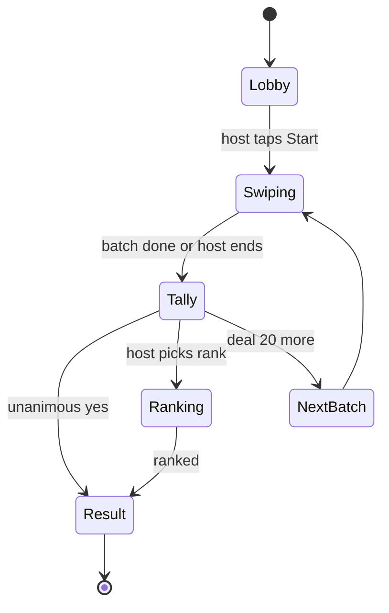

# Restaurant Picker Project Spec

Nov 4, 2026 · @Darren Ath-Ly

## Overview

A mobile-first web app that takes a group of 2 to 8 friends from "where should we eat?" to a decision in about five minutes. The host sets filters, friends join from a link with no account, everyone swipes yes, no, or veto on nearby restaurants dealt in batches of 20, and a voting rule picks the winner from the places people approved.

The app works anywhere Google Places has data. Testing and the first launch focus on Boston, Cambridge, and Somerville, and V2's curated menu highlights cover only that area. The look borrows Too Good To Go's photo cards and bottom sheets, and the longer-term idea borrows Beli's taste memory. The stack is Next.js, Supabase, and Vercel, built with Claude Code.

## Features

The MVP is the full loop for one group in one sitting. Everything that needs accounts, history, or extra APIs waits for V2.

### MVP

- **Create a session.** Host picks a max price level (1 to 4 dollar signs), max distance from the group (1, 2, or 5 miles), open now, and vegetarian options, then gets a link and a 6-character code.
- **Join with no account.** Friends open the link, type a display name, and share location. Anonymous sign-in happens behind the scenes.
- **Live lobby.** Everyone sees who has joined in real time. Only the host can start.
- **Swipe deck.** Restaurant cards with photo, name, price level, rating, distance from you, and an "open until" badge. Tapping a card opens a bottom sheet with hours, website or menu link, dietary flags, and a Google Maps link.
- **Yes, no, veto.** Swipe right, left, or up, with buttons as a fallback. Each person gets 2 vetoes.
- **Fair deck order.** Each member sees the cards in a different shuffled order, so early cards don't get extra yeses.
- **Hidden tallies.** Nobody sees vote counts until everyone finishes, only how many people are still swiping.
- **Instant match.** If every member says yes to the same place, skip ranking and show it.
- **Ranking round.** The top 5 finalists go to a drag-to-reorder screen, and Borda picks the winner.
- **Result screen.** Winner, runner-up, directions link, and a button to run it again.
- **Host controls.** The host can end swiping early when someone stalls. Unswiped cards count as no.
- **Batches with no cap.** Cards come 20 at a time, and everyone finishes a batch before the next one is dealt. After each batch, a unanimous yes ends it, 3 or more finalists let the host choose ranking or 20 more, and no finalists deals the next batch automatically.

### Later (V2)

- **Accounts and saved groups.** Upgrade anonymous users to Google sign-in so recurring friend groups persist.
- **Post-dinner ratings.** Beli-style ratings after the meal, used to suppress recent repeats and seed future decks.
- **Menu highlights.** Popular dishes and price ranges for a curated set of about 150 Boston and Cambridge restaurants.
- **Voting rule picker.** Let the host choose approval only, Borda, or Copeland.
- **Wildcard card.** One highly rated place per deck that misses a soft preference.
- **Install and notifications.** PWA install plus a push when everyone has finished swiping.

## Pages and screens

The app has three routes. The session page at `/s/[code]` swaps views based on the session's status, so Realtime updates move everyone forward without a page navigation.

### Routes

| Route | Screen | What it shows |
| --- | --- | --- |
| `/` | Home | Start a session button and a field to type a join code |
| `/new` | Create session | Filter form (price, max distance, open now, vegetarian) and the host's display name |
| `/s/[code]` | Session | One of the views below, picked by session status |

### Views inside `/s/[code]`

| View | When | What it shows |
| --- | --- | --- |
| Join | First visit to the link | Display name field and a location permission prompt |
| Lobby | Status is lobby | Map with every member's dot and the search circle, live member list, copy-link button, and the host's Start button |
| Swipe | Status is swiping | Map strip on the top 30% with the current pin and member dots, card deck below, vetoes left, and the details bottom sheet on tap |
| Waiting | You finished the current batch | "3 of 5 done with this batch" with no vote counts and the host's End swiping button. When everyone finishes, the host picks Go to ranking or Deal 20 more |
| Rank | Status is ranking | Top 5 finalists as cards you drag into order |
| Result | Status is done | Map with the winner's pin, winner card, runner-up, directions link, and Run it again |

### Map strip

A Google Map sits above the card on the swipe screen and takes about 30% of the height. It re-centers on each new card's pin and shows every member's dot, so the group can see at a glance whether a place is fair for everyone.

- **Google Map only.** Places results shown on a map must be on a Google Map, so Mapbox and MapLibre are out ([Places API policies](https://developers.google.com/places/web-service/policies)). A Google Map on the same screen also covers Google's attribution requirement, though photo author attributions still show on each card.
- **No gestures.** `gestureHandling="none"` sends sideways drags to the card instead of the map. Tapping the strip opens a full-screen map.
- **One load per phone.** Create the map once per session and pan it. Dynamic Maps get 10,000 free loads a month, then $7 per 1,000, which covers about 2,000 five-person sessions.
- **Second key.** The Maps JavaScript key runs in the browser, so restrict it by HTTP referrer to the Vercel domains. The Places key stays server-only.
- **Library.** `@vis.gl/react-google-maps` with `AdvancedMarker` pins, which need a Map ID.

### Server routes

These run on Vercel with the secret keys. Swipes and rankings write straight to Supabase, guarded by row-level security.

| Route | Does |
| --- | --- |
| `POST /api/sessions` | Creates the session and join code |
| `POST /api/sessions/[id]/start` | Host only. Deals the first batch of 20 with one Text Search call, resolves its photos, moves status to swiping |
| `POST /api/sessions/[id]/done-swiping` | Marks a member done with the batch. Once the whole group is, ends on a unanimous yes or counts finalists and offers the host ranking or another batch |
| `POST /api/sessions/[id]/deal` | Host only. Fetches the next page of results, or splits the area into smaller circles past 60, filters by distance, and deals 20 more |
| `POST /api/sessions/[id]/done-ranking` | Marks a member done. When everyone is done, computes the winner and moves status to done |
| `POST /api/sessions/[id]/end-swiping` | Host only. Ends swiping early and runs the same finalist step |

## Session lifecycle

The server tallies after every batch of 20, once everyone finishes it or the host ends swiping. A unanimous yes goes straight to the result. Otherwise the host either sends the finalists to ranking or deals 20 more, and a batch with no finalists deals the next one automatically.

## Voting design

Swipes are approval ballots with a veto, and Borda over the top 5 finalists picks the winner. All of it lives in `lib/voting.ts` as pure functions with Vitest tests, and it runs on the server so no client can tamper with the result.

1. **Swipe.** Each member marks every card in the current batch of 20 yes, no, or veto, and the next batch is dealt only after everyone finishes. Vetoes are capped at 2 per person for the whole session. Cards left unswiped when the host ends swiping count as no.
2. **Instant match.** A restaurant with a yes from every member wins outright. If several are unanimous, only those go to the ranking round.
3. **Finalists.** Drop every vetoed restaurant. Keep places where at least half the members said yes, then take the top 5 by yes count. If fewer than 2 qualify, relax to at least one yes.
4. **Rank.** Each member orders the finalists. With k finalists, first place earns k − 1 points and last place earns 0.
5. **Tie-break.** Higher Borda score, then more yeses, then higher Google rating, then a coin flip seeded by the session id so it is reproducible.

### Edge cases

| Case | Rule |
| --- | --- |
| One member | Skip ranking if they said yes to exactly one place. Otherwise they rank their yeses. |
| Zero finalists | Deal the next batch automatically. If the area runs out of places, offer to widen the max distance. |
| Someone stalls | Host ends swiping. Their missing swipes count as no, and a missing ranking is left out of Borda. |
| Two members finish at once | The status change uses a conditional update (`where status = 'swiping'`), so it runs exactly once. |
| Member joins after start | They can watch but don't vote this round. |

Tallies stay hidden during swiping to cut strategic voting, and per-member shuffles within each batch cancel the bias toward early cards. Because everyone sees every dealt card before the next batch, approval counts stay comparable even with no cap on the deck. Borda can be gamed by burying a rival, which is fine among friends. Copeland is the V2 option for anyone who wants the Condorcet winner whenever one exists.

## Data sources

Each batch of 20 cards takes one Google Places search and 20 photo lookups, and the deck has no cap. Menus have no API, so the MVP links out.

| Source | Used for | Calls | Version |
| --- | --- | --- | --- |
| Places API (New) Text Search | Batches 1 to 3, up to 60 places per area at 20 per page | 1 per batch | MVP |
| Places API (New) Nearby Search | Batches past 60, by splitting the area into smaller circles and removing duplicates by place ID | 1 per smaller circle | MVP |
| Places API (New) Place Photos | One photo per card | 20 per batch | MVP |
| Restaurant's own website | Menu link in the bottom sheet | 0 | MVP |
| Curated menu summaries | Popular dishes for about 150 restaurants | 0 (built once) | V2 |

Nearby Search returns at most 20 places with no next page, which is why batches start with Text Search. When paging, every request field except the page token must match the first request, so the session stores the original request body and the latest `nextPageToken`. Text Search treats the circle as a preference, not a hard limit, so each batch is filtered by distance before it is dealt.

### Search field mask

Google bills a request at the highest tier among the fields you ask for ([source](https://developers.google.com/maps/billing-and-pricing/sku-details/places)). The deck needs fields from three tiers.

| Tier | Fields |
| --- | --- |
| Pro | `places.id`, `places.displayName`, `places.location`, `places.photos`, `places.googleMapsUri` |
| Enterprise | `places.rating`, `places.userRatingCount`, `places.priceLevel`, `places.currentOpeningHours`, `places.websiteUri` |
| Enterprise + Atmosphere | `places.servesVegetarianFood` |

The vegetarian flag pushes every search to the top tier. That costs nothing extra inside the free cap, since both Enterprise tiers get 1,000 free calls a month.

### Photos

The batch route resolves each photo once with `skipHttpRedirect=true` and stores the returned `photoUri` on the restaurant row. Every member's browser loads that URI directly, so photo charges stay at 20 per batch no matter how many people join. A proxy route would bill once per photo per phone instead.

Store Places content only for the life of a session, and read Google's terms before keeping anything longer.

## Tech stack and data model

Browsers talk to Supabase directly for auth, reads, swipes, and live updates. Anything that needs a secret key or decides an outcome runs in a Next.js server route on Vercel.

### Stack

| Layer | Choice | Role |
| --- | --- | --- |
| Framework | Next.js App Router, TypeScript | Pages plus server routes that hold secret keys |
| Styling and motion | Tailwind, Motion | Mobile-first layout and swipe gestures |
| Database and auth | Supabase Postgres, anonymous sign-in | Session data, row-level security, no-signup joins |
| Live updates | Supabase Realtime | Lobby presence and status changes pushed to every phone |
| Hosting | Vercel | HTTPS preview URL per push, needed for phone geolocation |
| Tests | Vitest | Unit tests for `lib/voting.ts` |
| Build tool | Claude Code with the Supabase MCP server | Writes code and applies migrations on the dev project |

### Tables

| Table | Key columns | Members can read | Members can write |
| --- | --- | --- | --- |
| `sessions` | `id`, `code`, `host_id`, `status`, `filters` (jsonb), `center_lat`, `center_lng`, `batch`, `search_body` (jsonb), `page_token` | Their own session | Nothing (server only) |
| `members` | `session_id`, `user_id`, `display_name`, `lat`, `lng`, `vetoes_left`, `done_swiping` (current batch), `done_ranking` | Everyone in their session | Their own row |
| `restaurants` | `session_id`, `place_id`, `batch`, `data` (jsonb with name, price, rating, `photoUri`, hours, links, flags) | Their session's dealt cards | Nothing (server only) |
| `swipes` | `session_id`, `user_id`, `place_id`, `value` (yes, no, veto); unique per user and place | Only their own | Only their own |
| `rankings` | `session_id`, `user_id`, `ordering` (text array) | Only their own | Only their own |
| `results` | `session_id`, `finalists`, `scores` (jsonb), `winner_place_id`, `runner_up_place_id` | Their session's result | Nothing (server only) |

Because members can only read their own swipes, tallies stay hidden by the database itself, not just the UI. The server reads all swipes with the secret key when it computes finalists.

Grants follow the table above. `authenticated` (the role anonymous sign-ins use) gets select on everything a member can read, plus insert and update on `members`, `swipes`, and `rankings` limited to the columns a phone legitimately sets (`display_name`, `lat`, `lng` on members; `value` on swipes; `ordering` on rankings, plus the key columns on insert). `vetoes_left`, the done flags, and `created_at` stay server-owned. Because a PostgREST upsert sets every payload column, clients insert and then update instead of upserting. `anon` gets nothing, and `service_role` is granted everything explicitly because new Supabase projects give the API roles no table access by default. The membership check behind every "their session" policy is `private.is_session_member`, a security-definer function in a schema the Data API does not expose. Migrations live in `supabase/migrations/` and are applied to the dev project through the Supabase MCP server, `lib/database.types.ts` is regenerated after each one, and `npm run rls:check` proves the swipe isolation with two anonymous users.

### Environment variables

| Variable | Exposed to browser |
| --- | --- |
| Supabase URL | Yes |
| Supabase publishable key | Yes |
| Supabase secret key | No |
| `GOOGLE_PLACES_API_KEY` | No |
| `NEXT_PUBLIC_MAPS_KEY` | Yes (restricted to Maps JavaScript API and your domains) |
| `NEXT_PUBLIC_MAP_ID` | Yes |

## Costs

Running the MVP costs $0 a month up to about 50 batches of 20 cards across all groups. Past that, each batch costs about $0.18 in Google fees, and the only fixed cost is a Claude plan for Claude Code if you don't already have one.

### By service (USD)

| Service | Plan | Free allowance that matters | Price past it | MVP cost |
| --- | --- | --- | --- | --- |
| Google Text Search (Enterprise + Atmosphere) | Pay as you go | 1,000 calls a month | $40 per 1,000 | $0 |
| Google Place Photos | Pay as you go | 1,000 photos a month | $7 per 1,000 | $0 up to 50 batches |
| Supabase | Free | 500 MB database, 50,000 monthly active users, 200 concurrent Realtime connections, 2 million Realtime messages | Pro at $25 a month | $0 |
| Vercel | Hobby | 1 million function invocations, 100 GB data transfer | Pro at $20 per user a month | $0 |
| Claude Code | Claude Pro | Included in paid Claude plans | About $20 a month (approximate) | $0 if already subscribed |
| Custom domain | Optional | None | About $10 to $15 a year (approximate) | $0 (use the Vercel URL) |

Google prices come from the [Google Maps Platform price list](https://developers.google.com/maps/billing-and-pricing/pricing), Supabase limits from [Supabase pricing](https://supabase.com/pricing), and Vercel limits from the [Vercel Hobby plan docs](https://vercel.com/docs/plans/hobby). The Claude price is approximate; confirm it at claude.com/pricing.

### Per batch

One batch is 1 Text Search call plus 20 photos. Photos run out first, at 1,000 ÷ 20 = 50 free batches a month. Past the free caps, a batch costs 1 × $0.040 + 20 × $0.007 = $0.18, so a group that swipes through 3 batches costs about $0.54.

### By monthly volume (USD)

| Batches a month | Google | Supabase | Vercel | Total |
| --- | --- | --- | --- | --- |
| 50 (testing with friends) | $0 | $0 | $0 | $0 |
| 200 (campus launch) | $21 | $0 | $0 | $21 |
| 1,000 (growth) | $133 | $0 to $25 | $0 to $20 | $133 to $178 |

At 1,000 batches, Text Search is still inside its 1,000 free calls, and photos cost (20,000 − 1,000) × $7 ÷ 1,000 = $133. Supabase Pro becomes worth it for reliability, since free projects pause after a week of inactivity. Vercel Pro is required only if the app makes money, because Hobby is for non-commercial personal use.

Set daily request quotas on both Places SKUs in Google Cloud, so a bug that loops on the batch route stops at the quota instead of running up a bill.

## Build plan

Eight phases, each one Claude Code session that ends with something you can click through on your phone. Every phase follows the same loop of clear context, plan mode, review the plan, implement, verify, and commit.

1. **Accounts and keys.** Google Cloud project with Places API (New), a restricted key, and daily quotas. Supabase dev project with anonymous sign-ins on. A curl test that returns 5 Harvard Square restaurants.
2. **Scaffold and deploy.** Next.js app, CLAUDE.md with project rules, repo on GitHub, and Vercel previews on every push. Delivers an HTTPS URL that works on your phone.
3. **Database and security.** Supabase MCP connected, migrations for all six tables, RLS policies, and a script proving one user can't read another's swipes.
4. **Batch route.** One Text Search page per batch with the field mask above, a stored request body and page token, distance filtering, photos resolved per batch, and a check that re-requesting a batch doesn't hit Google again.
5. **Session flow.** Create page, join link, anonymous sign-in, live lobby, and a Start button that moves every phone to the deck.
6. **Swipe UI.** Cards, bottom sheet, swipe gestures with button fallbacks, vetoes, per-member shuffle, the waiting screen, and the host's Go to ranking or Deal 20 more choice.
7. **Voting and results.** Vitest tests first, `lib/voting.ts` written by you, server-side finalist and winner steps with conditional updates, ranking screen, and result screen.
8. **Real-group test.** One dinner with 4 to 6 friends. Track how long swiping takes, how many batches groups need, whether anyone vetoes, and the Places calls per session in Google Cloud.

## Risks and open decisions

The biggest risks are a stalled group and surprise Google bills, and both have fixes built into the MVP.

| Risk | Fallback |
| --- | --- |
| A member denies location | Center the deck on the host's location; that member still votes |
| One person stops swiping | Host taps End swiping; their missing cards count as no |
| The area runs out of places | Offer to widen the max distance one step |
| A bug loops on the batch route | Daily quotas on both Places SKUs stop it at the cap |
| Supabase free project pauses after a week idle | Restore it from the dashboard before a demo, or move to Pro once real users arrive |
| Google limits on storing Places content | Delete restaurant rows when a session ends, and check Google's Places policies for exact rules |
| The app starts making money | Move Vercel to Pro first, since Hobby is non-commercial only |

### Open decisions

- [ ] App name
- [ ] Max distance options (1, 2, and 5 miles, or others)
- [ ] Deck center at the host's location or the group's midpoint
- [ ] Finalist count of 3 or 5
- [ ] Veto limit of 1 or 2 per person
- [ ] Typed-neighborhood fallback for denied location (Geocoding gives 10,000 free requests a month, then $5 per 1,000)
- [ ] Accounts in the MVP or deferred to V2
- [ ] How a friend resolves a join code before they are a member, since `sessions` is readable only by its members and host: a security-definer `join_session(code, display_name, lat, lng)` function that inserts the member row and returns the session (keeps session rows private), or a `sessions` select policy open to any signed-in user

## Sources

- [Google Maps Platform core services price list](https://developers.google.com/maps/billing-and-pricing/pricing)
- [Google Places (New) SKU details](https://developers.google.com/maps/billing-and-pricing/sku-details/places)
- [Supabase pricing](https://supabase.com/pricing)
- [Vercel Hobby plan](https://vercel.com/docs/plans/hobby)
